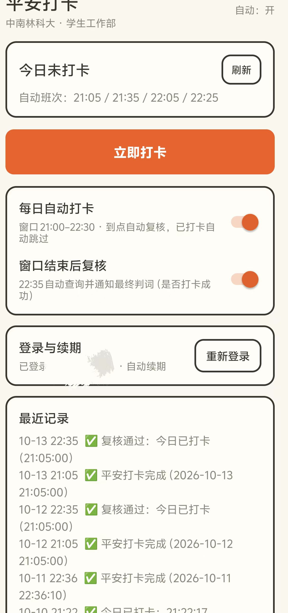

# 平安打卡 · csuft-checkin

> 中南林业科技大学学工部「平安打卡」的 Android 自动化客户端 —— 手机号短信登录一次，之后全自动续期与打卡；每日定时窗口自动执行 + 结果复核通知。纯 HTTP 实现，运行时无需微信、也不需要服务器。

<p align="center">
  
</p>

个人自用工具，仅供学习交流。**使用须知与免责声明见文末。**

## ✨ 它能做什么

- 🔐 **手机号短信登录一次**（学校 CAS 官方免密登录）→ 之后 `refresh_token` 自动续期，无需再登录
- ⏰ **每日自动打卡**：21:05 / 21:35 / 22:05 / 22:25 四个班次自动尝试，已打卡自动跳过、静默不打扰
- ✅ **22:35 复核**：窗口结束后自动查询并通知最终判词
- 🎯 **坐标两级随机**：以宿舍登记点为原点两级随机（距其约 2~791 m），每次提交都不同
- 📋 **运行日志 + 后台心跳**：出问题能看到卡在哪一步，便于自诊断
- ⚡ **免杀引导**：电池优化白名单 / 自启动 / 后台高耗电，按界面提示点几下即可

## 为什么我们不怕二次认证以及完全 0 门槛自动化？（与同校其他软件相比）

学校账号启用了**短信二次认证**。同校常见的另一条路线（采集微信小程序会话）因此走不通「学号 + 密码」，只能抓包把会话 token 采出来复用：使用者要配合装证书、开代理、被别人采集一次，而且 **token 约 18–20 天过期，需要重新采集**。

我们直接走 **CAS 官方短信登录** —— 「二次认证」在我们这里就是「唯一一次认证」：

| 对比项 | 本项目 | 常见路线（小程序会话采集） |
| --- | --- | --- |
| 登录方式 | 官方短信免密登录（本人一次） | 抓包采集小程序会话 |
| 证书 / 代理 | **不需要** | 需要（临时安装） |
| 长期维护 | **refresh_token 自动续期** | token 约 18–20 天过期需重采 |
| 凭据存放 | **只在本人手机** | 部署方服务器集中保管 |
| 请求出口 | **每台手机独立** | 默认同一服务器 IP |
| 提交坐标 | **两级随机（每次不同）** | 多为固定坐标 |

一句话：**装好 App、收一条本人短信，之后全自动。**

> 两条路线没有绝对好坏：服务器形态也有它的长处（手机不在线也能打卡、便于批量管理）。本项目按「个人自用、隐私优先、免维护」的目标取舍。

## 📱 开始使用

1. 安装 APK（自行构建，或向分享者索取）
2. 打开 App →「手机号登录」→ 收取一次短信验证码
3. 保持两个开关开启，并按界面提示完成免杀设置 —— 之后每天自动打卡 + 复核通知

## 🔨 构建

```bash
# 依赖：bash + JDK（javac）+ Android SDK（build-tools 36.1.0 / platform android-36.1）
bash build.sh    # 产物默认输出到仓库上一级目录
```

机器路径不同时用环境变量覆盖：`ANDROID_SDK` / `JAVA_BIN` / `CHECKIN_OUT_DIR`。流水线为纯手工 `aapt2 → javac → d8 → zipalign → apksigner`，无需 gradle。

## 📂 结构

```text
src/com/csuft/checkin/
├── MainActivity.java      # 主界面：状态卡 / 登录 / 开关 / 日志 / 白名单
├── Auth.java              # CAS 短信登录 + 换票 + OAuth 续期
├── CheckinCore.java       # 打卡核心：三接口 + 实时签名 + 两级随机坐标
├── CheckinScheduler.java  # 精确闹钟班次调度 + 心跳
├── TriggerReceiver.java   # 闹钟 / 开机广播
├── Notify.java            # 通知
├── Store.java             # 本地状态与运行日志
└── Secrets.java           # 客户端级公共常量（无个人凭据）
res/                       # 布局 / 字符串 / 图标 / 主题
build.sh                   # 构建流水线
assets/                    # 界面截图
```

## ⚠️ 须知与免责

- 个人自动化学习交流用途；打卡数据以学校系统为准，请遵守学校相关规定，使用风险自负
- 仓库不含任何个人凭据（账号 / 令牌 / 学号均只存于手机本地）；任务 ID、登记点坐标等为学校侧公共配置常量
